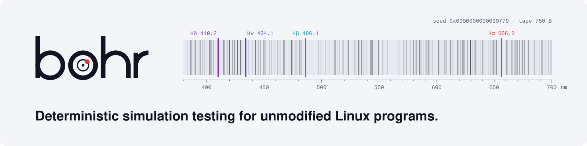

<div align="center">

<picture>
  <source media="(prefers-color-scheme: dark)" srcset="docs/assets/banner-dark.svg">
  
</picture>

[](https://github.com/KDaniello/bohr/actions/workflows/test.yml)
[](https://github.com/KDaniello/bohr/actions/workflows/determinism.yml)
[](https://github.com/KDaniello/bohr/actions/workflows/nightly.yml)
[](https://github.com/KDaniello/bohr/actions/workflows/sdk.yml)

[Overview](./docs/OVERVIEW.md) ·
[Architecture](./docs/ARCHITECTURE.md) ·
[API](./docs/API.md) ·
[Determinism map](./docs/DETERMINISM.md) ·
[Testing](./docs/TESTING.md) ·
[Evidence](./docs/EVIDENCE.md) ·
[Changelog](./CHANGELOG.md)

<picture>
  <source media="(prefers-color-scheme: dark)" srcset="docs/assets/divider-dark.svg">
  
</picture>

</div>

## Overview

bohr runs a Linux program as its project releases it, inside a deterministic world. The world
supplies time, randomness, thread scheduling, the network and the disk. Every decision the world
makes is drawn from one string of bytes, the **entropy tape**, and one 64-bit seed defines the tape.

On that world, bohr kills and restarts nodes, partitions and degrades the network, tears and
reorders unsynced writes, fills the disk, fails `fsync`, refuses allocations and moves the clock. A
campaign searches for the tape that breaks the program. Every finding is a bundle that replays to
the same digest on another machine, shrinks to the fewest faults that still break the program, and
stages on a real host without bohr.

## Features

- **Unmodified programs.** Linux x86-64 binaries, static or dynamically linked, run under a
  `ptrace` supervisor with a seccomp pre-filter. No source changes, no rebuild, no hypervisor.
- **Clusters in one world.** Several programs run as nodes of one network, each with its own
  address, disk and clock, from a prepared state directory pinned by digest.
- **Faults.** Process kill and freeze; network partition, drop, delay, duplication, reordering and
  corruption; torn and reordered writes, disk stalls, `ENOSPC` and `EIO`; `ENOMEM`; clock steps and
  drift; restore from an older snapshot; chain reorganisation.
- **Oracles.** Crashes, hangs, SDK assertions, durability of acknowledged writes, liveness, and
  probes over a node's JSON-RPC: finality, agreement between nodes, a moving head, one signature
  per height.
- **Target packs.** `bohr hunt <pack>` builds or checks the pinned binary of a target, runs its
  campaign and groups its findings.
- **Findings that explain themselves.** `bohr explain` gives the verdict, where the program fell
  (a Go or Rust panic frame with its module version, or the last fatal log line), and the faults
  before it. `bohr findings` groups bundles by cause and by place.
- **Reduction.** `bohr reduce` shrinks the tape and the faults of a finding while it keeps its
  signature.
- **Confirmation on a real host.** `bohr confirm` writes a script that stages the recorded faults
  with real processes, `kill -9` and a dm-flakey device, and reports the reproduction rate.
- **Reports.** A self-contained HTML page, a disclosure draft in Markdown, SARIF 2.1.0, and the
  event log as JSON Lines.
- **Automation.** Every command takes `--json`; `bohr mcp` serves the commands to coding agents
  over stdio; `action/` fails a pull request on a finding.

## Supported targets

| Target | Version | Language | Pack | Judged by |
|---|---|---|---|---|
| go-ethereum | v1.17.10 | Go | `targets/geth` | exit status, JSON-RPC probes of the head |
| CometBFT | v0.38.26 | Go | `targets/cometbft`, `targets/cometbft-net` | exit status, finality, agreement and liveness probes; a transaction driver on four validators |
| reth | `3641f10` | Rust | `targets/reth` | exit status |
| op-reth | v2.6.1 | Rust | `targets/op-reth` | exit status |
| redb | 2.6.3 | Rust | `targets/redb` | acknowledged, lost and resurrected writes through `examples/redb-hunt` |

A pack is a directory: the repository and commit, a build script, the binary's blake3 digest, and
the scenarios. Any other static Linux program runs with `bohr run` and a scenario of its own.

## Measured

Every figure below is recorded in [`benches/baseline.toml`](./benches/baseline.toml) with its host
and command; [EVIDENCE.md](./docs/EVIDENCE.md) maps each claim to its check.

| Property | Result |
|---|---|
| Repeatability | 1 000 runs of one seed under every fault kind: one trace digest |
| Portability | 9 of 9 bundles written by a Windows build replay on a Linux build, digest for digest |
| Cost of an intercepted syscall | 4.25 µs |
| Guest startup | 3.07 ms |
| Campaign throughput | redb: 64 runs in 3.1 s on one worker, in 1.04 s on four; 98 784 runs in 30 minutes on four workers |
| Worker memory | 14.4 MB peak |
| Reduction | a fixture from 49 477 events to 18; a finding in a real client from 27 577 events to 5 923 in 200 replays |
| Release binary | 8.4 MB, static, the same SHA-256 from two build directories |

## Installation

Requirements: Linux x86-64, kernel 5.4 or newer (5.15 recommended), an unprivileged user, and the
Rust toolchain that [`rust-toolchain.toml`](./rust-toolchain.toml) pins. Packs of Go targets build
with Go. The full matrix is in [PLATFORMS.md](./docs/PLATFORMS.md).

```bash
git clone https://github.com/KDaniello/bohr && cd bohr
make build                     # target/release/bohr
make probe                     # the JSON-RPC probe, built static where bohr finds it
target/release/bohr doctor     # kernel features, ptrace scope, user namespaces, seccomp
```

On Ubuntu 23.10 and later, AppArmor restricts unprivileged user namespaces; `bohr doctor` prints the
one `sudo` command that allows the binary ([PLATFORMS.md](./docs/PLATFORMS.md) §7).

A published release installs with `bohrup`, which checks the signature on `SHA256SUMS` and every
file against it before anything runs:

```bash
curl -sSf https://github.com/KDaniello/bohr/releases/latest/download/bohrup.sh | sh
```

## Quick start

Hunt a target from its pack, then read what it found:

```bash
bohr hunt redb --runs 2000 -j 2 -o hunt-redb
bohr findings hunt-redb/findings              # groups, each led by its smallest bundle
bohr explain  hunt-redb/findings/<bundle>     # the verdict, where it fell, the faults before it
```

Work with one finding:

```bash
bohr replay  finding.bohr                     # the same run, checked against its digest
bohr reduce  finding.bohr -o minimal.bohr     # the fewest faults that keep the signature
bohr report  minimal.bohr -o report.html      # one page with the timeline
bohr confirm minimal.bohr -o confirm.sh       # stage it on a real host, as root
```

Start from your own program:

```bash
bohr doctor --target ./my-service             # can this host run it, and is it supported
bohr run --seed 42 -- ./my-service            # one deterministic run
bohr run --seed 42 --repeat 1000 -- ./my-service
bohr init --nodes 3 -- ./my-service           # a first scenario.toml from a survey of the program
bohr explore --time 10m -j 8 --config scenario.toml -- ./my-service
```

What `bohr explain` prints for a program that logs a fatal line and exits:

```
What was found
  a guest failed: exit status 1 (GuestCrashed)

Where it fell
  n0 (start 1)  fatal line: ERROR: failed to open the store at height 41: entry point missing

What the run was
  seed 1 · 1 node · 0.000 s virtual · 7 events · 0 faults landed
```

## Scenarios

A scenario is a TOML file: the nodes, the prepared state, the disk, the faults and the oracles.

```toml
[run]
horizon_ticks = 25_000_000_000           # 25 s of virtual time

[state]
dir = "targets/cometbft-net/state"       # copied into every node's filesystem, pinned by digest

[cluster]
nodes = 5
programs = [
  ["targets/cometbft/build/cometbft", "start", "--home", "/net/node0", "--proxy_app", "kvstore"],
  # … nodes 1–3 …
  ["examples/comet-driver/build/comet-driver"],
]

[disk]
sync_semantics = "strict"                # a crash keeps exactly what was synced
reorder_unsynced = true

[faults]
kill_probability = "1/65536"
restart_after_ticks = 1_000_000_000
arm_after_ticks = 3_000_000_000
budget_per_run = 3
draw = ["node_kill", "node_freeze", "node_isolate", "node_degrade"]

[[probe]]
name = "finality"
port = 26657
rpc = "block"
params = {}
every_ticks = 1_000_000_000
key = "block.header.height"
value = "block_id.hash"
property = "never-reverts"
```

Every key is documented in [API.md](./docs/API.md) §5, and an unknown key is refused by name.

## SDK

bohr finds crashes, hangs and lost writes with no annotation. The SDK adds what a program means:

```rust
bohr::always!(log.is_monotonic(), "log index is monotonic");
bohr::sometimes!(leader_changed && disk_full, "leader change under a full disk");
bohr::fault_point("before_commit_ack");
```

Every call is a no-op outside bohr. The output format is compatible with the Antithesis SDKs.
SDKs exist for Rust, Go, Python, C and C#, and one conformance suite holds them to one schema.

## Integrations

| Integration | Interface |
|---|---|
| Programs | `--json` on every command: one object with its schema name, `bohr.error/1` on failure |
| Coding agents | `bohr mcp`: the commands as Model Context Protocol tools over stdio ([API.md](./docs/API.md) §7.12) |
| CI | `action/`: installs a release, hunts a pack, attaches the bundles, a report and SARIF, fails the job on a finding |
| Containers | run with `--cap-add SYS_PTRACE --security-opt seccomp=unconfined --security-opt apparmor=unconfined` |

## Limitations

- bohr runs guests on Linux x86-64. The core builds and tests on macOS and Windows.
- A dynamically linked guest runs with the libraries its loader opens placed in the prepared state
  ([PLATFORMS.md](./docs/PLATFORMS.md)). `bohr confirm` stages static programs.
- bohr judges crashes, hangs, SDK assertions, acknowledged writes and the probes a scenario
  declares. A campaign without a finding is a statement about exactly those checks.
- An unmodelled syscall ends the run with a named error. `RDRAND` executes on the host; the
  [determinism map](./docs/DETERMINISM.md) lists it with every other source and its treatment.
- Guided fault targeting performs at the level of uniform choice on the defect it was measured
  against ([API.md](./docs/API.md) §5.4).
- One run uses one host. A network of four Go validators reaches about 20 s of virtual time per run.
- `ptrace` supervision gives reproducibility and no isolation; see [Security](#security).

## Status

Version 0.9.0. The tape ABI, the bundle format, the SDK schema and the command line change between
versions; every bundle records the four numbers, and [CHANGELOG.md](./CHANGELOG.md) states each
change with what still replays. Findings in other projects go to their maintainers first and are
published after a fix or with their agreement.

## Documentation

| Document | Contents |
|---|---|
| [OVERVIEW.md](./docs/OVERVIEW.md) | the machine end to end, in one sitting |
| [ARCHITECTURE.md](./docs/ARCHITECTURE.md) | components, boundaries, the invariants the code follows |
| [API.md](./docs/API.md) | the tape ABI, the bundle format, the SDK schema, the CLI, every error code |
| [DETERMINISM.md](./docs/DETERMINISM.md) | every source of nondeterminism and its treatment |
| [TESTING.md](./docs/TESTING.md) | the test pyramid, the determinism gates, the seeded defects |
| [EVIDENCE.md](./docs/EVIDENCE.md) | each claim, its measurement and its command |
| [PLATFORMS.md](./docs/PLATFORMS.md) | host requirements, kernel features, the guest matrix |

## Development

```bash
make test-fast    # unit, property and integration tests; any OS, under a minute
make test         # everything this host can run
make pr           # what CI runs on a pull request
```

The scheduler, the world, the explorer and the reducer are sans-io state machines, so they build and
test on every OS. The syscall backend builds on Linux only, and a run elsewhere skips it.
[AGENTS.md](./AGENTS.md) maps each area to its files and its check;
[CONTRIBUTING.md](./CONTRIBUTING.md) covers the workflow.

## Getting help

- **Bugs:** an issue with the seed or the bundle. A bundle reproduces the run on its own;
  `bohr report --redact` removes guest data and keeps the run's structure
  ([API.md](./docs/API.md) §4.6).
- **Questions:** GitHub Discussions.
- **Design:** an issue labelled `S-needs-decision`, naming the section of
  [ARCHITECTURE.md](./docs/ARCHITECTURE.md) it concerns.

## Security

Report vulnerabilities as [SECURITY.md](./SECURITY.md) describes.

> [!WARNING]
> bohr provides reproducibility and no containment. A program under `ptrace` supervision can escape
> it. Run untrusted code in a virtual machine.

bohr sends no telemetry. Building a pack downloads its target from the source the pack names;
everything bohr produces is written to the local disk.

## Acknowledgements

bohr builds on published work and on tools that shaped it: `rr` for record-and-replay engineering
and the seccomp pre-filter technique; Hermit for syscall-level determinism and its limits; PCT
(Microsoft Research, ASPLOS 2010) and AWS Shuttle for randomised scheduling with guarantees; loom and
turmoil for in-process simulation; AFL++ for mutation engineering; Jepsen for the practice of
reporting findings privately and publishing them carefully; Antithesis for defining the category
and for the SDK format bohr is compatible with.

## License

Licensed under the [Apache License, Version 2.0](./LICENSE-APACHE).
